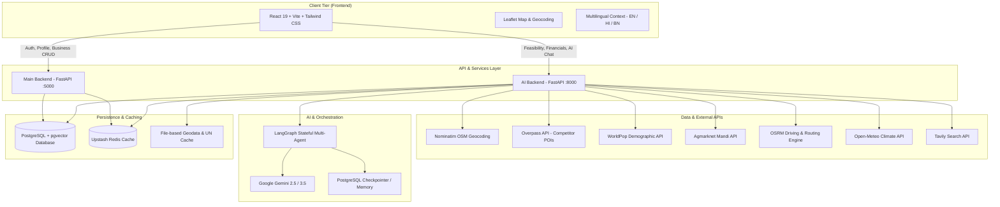
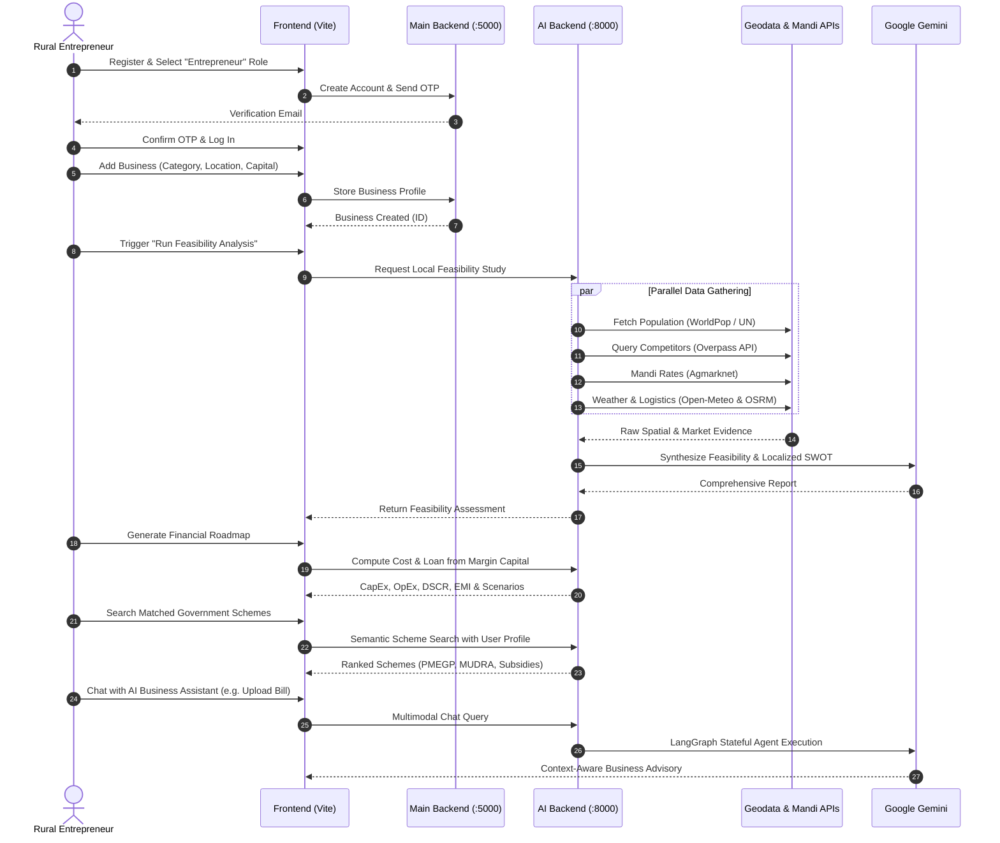

# ArthNiti (অর্থনীতি) — AI-Powered Rural Business Advisory & Financial Assistant

<p align="center">
  <strong>Build the Right Business. Backed by Local Data.</strong><br>
  <em>Institutional-grade business intelligence and financial structuring for rural and semi-urban micro-entrepreneurs.</em>
</p>

<p align="center">
  
  
  
  
  
  
  
  
</p>

---

## 📌 Table of Contents

- [Overview](#-overview)
- [The Problem & The Vision](#-the-problem--the-vision)
- [Key Features & Modules](#-key-features--modules)
  - [1. Hyper-Local Business Feasibility Engine](#1-hyper-local-business-feasibility-engine)
  - [2. Smart Financial Structuring & Scenario Modeling](#2-smart-financial-structuring--scenario-modeling)
  - [3. Semantic Government Schemes Recommender](#3-semantic-government-schemes-recommender)
  - [4. Dual Conversational AI Assistants](#4-dual-conversational-ai-assistants)
  - [5. Multilingual & Grassroots Accessibility](#5-multilingual--grassroots-accessibility)
  - [6. Multi-Role Ecosystem & Business Directory](#6-multi-role-ecosystem--business-directory)
- [System Architecture](#-system-architecture)
- [Data Sources & External APIs](#-data-sources--external-apis)
- [Repository Structure](#-repository-structure)
- [Getting Started](#-getting-started)
  - [Prerequisites](#prerequisites)
  - [Environment Variables](#environment-variables)
  - [Backend Setup](#backend-setup)
  - [Frontend Setup](#frontend-setup)
  - [Quick Start (One-Click)](#quick-start-one-click)
- [API Reference](#-api-reference)
- [Workflow & User Journey](#-workflow--user-journey)
- [Security & Guardrails](#-security--guardrails)
- [Contributing & License](#-contributing--license)

---

## 📖 Overview

**ArthNiti** (*অর্থনীতি* — Sanskrit for *Economic Strategy & Governance*) is an intelligent, hyper-local business advisory and financial structuring platform tailored for rural and semi-urban entrepreneurs. 

Rather than relying on generic rules-of-thumb, ArthNiti gathers real-time physical indicators—including demographic density, competitor distribution, agricultural APMC mandi pricing, regional weather volatility, and road logistics—to produce rigorous feasibility analyses. It then reverse-engineers a personalized financial roadmap from the entrepreneur's own margin capital, calculates debt capacity and EMI schedules, and identifies high-probability government subsidies and schemes (MUDRA, PMEGP, MSME schemes, and state-level grants).

---

## 🎯 The Problem & The Vision

- **High Micro-Enterprise Failure Rates:** Over 60% of rural micro-enterprises fail within 3 years due to copycat ventures, market saturation, and ignorance of hyper-local demand.
- **The Financial Structuring Gap:** Aspiring entrepreneurs often have small margin capital (e.g., ₹50,000–₹1,00,000) but don't know what scale of business is feasible or how much bank debt they can safely service.
- **Underutilized Government Schemes:** Hundreds of central and state subsidy schemes exist, yet grassroots founders struggle with complex eligibility rules and documentation barriers.
- **Language & Literacy Barriers:** High-level consulting is confined to corporate metros in English. ArthNiti delivers data-backed advisory in **English**, **Hindi (हिंदी)**, and **Bengali (বাংলা)**.

---

## 🚀 Key Features & Modules

### 1. Hyper-Local Business Feasibility Engine
Evaluates enterprise viability across a 5–10 km radius using empirical spatial and economic data:
- **Demographics & Population:** Integrates the UN Household Size dataset and WorldPop geospatial density to calculate addressable customer reach and household counts.
- **Competitor Mapping:** Queries OpenStreetMap (Overpass API) to locate nearby businesses, calculate market density, compute saturation scores, and highlight underserved niches.
- **Mandi Price Intelligence:** Fetches real-time and historical commodity price benchmarks from Agmarknet APMC mandis.
- **Supply Chain Infrastructure:** Analyzes regional raw material sourcing, proximity to cold storage, food parks, and processing facilities.
- **Logistics & Freight Simulator:** Leverages OSRM (Open Source Routing Machine) to calculate driving routes, operational road transit costs, fuel overhead, and optimal vehicle types.
- **Seasonal & Climatic Risk:** Analyzes multi-year agro-climatic trends from Open-Meteo, cross-referencing rainfall and climate risks against seasonal demand patterns.
- **AI Feasibility Report:** Generates an executive summary, localized SWOT analysis, viability scoring, and tailored mitigation strategies.

### 2. Smart Financial Structuring & Scenario Modeling
Turns available margin capital into a comprehensive, bank-ready financial roadmap:
- **Capital Engineering:** Reverse-calculates feasible total project cost, debt-to-equity ratio, and bank borrowing capacity from the founder's initial equity.
- **Tri-Scenario Stress Testing:** Evaluates **Expected**, **Best**, and **Worst-case** cash flows under adverse market conditions.
- **Operational Viability:** Estimates CapEx, OpEx (rent, wages, raw materials, power), gross margin, net profit margin, and monthly break-even sales.
- **Debt Capacity & DSCR:** Computes loan eligibility, monthly EMI, recommended tenure, moratorium grace period, and Debt Service Coverage Ratio (DSCR).

### 3. Semantic Government Schemes Recommender
- **Vectorized Schemes Knowledge Base:** Vector embeddings stored in PostgreSQL via `pgvector` indexing comprehensive Indian welfare, MSME, and entrepreneurship schemes.
- **Eligibility Matching:** Automatically filters based on location, business category, promoter social group, gender, annual turnover, and landholding status.
- **Subsidy & Grant Calculation:** Estimates capital subsidies, interest subvention rates, required margin contributions, and generates step-by-step application checklists with official links (including MyScheme integration).

### 4. Dual Conversational AI Assistants
- **Platform Onboarding Assistant:** RAG-powered chatbot embedded across the application to answer user queries regarding navigation, feature workflows, and platform policies.
- **Workspace AI Business Consultant:** A LangGraph-orchestrated assistant equipped with persistent conversation memory (PostgreSQL checkpointer / Redis), tool-calling capabilities, and multimodal vision for analyzing uploaded equipment invoices, receipts, and storefront images.

### 5. Multilingual & Grassroots Accessibility
- Switch between **English**, **Hindi (हिंदी)**, and **Bengali (বাংলা)** with instant UI localization and LLM-powered report translations.
- Voice-friendly and mobile-responsive layout for field accessibility.

### 6. Multi-Role Ecosystem & Business Directory
- **Entrepreneur:** Manage multiple enterprises, initiate multi-criteria feasibility reports, and formulate financial models.
- **Buyer:** Search the active business directory to discover local producers, compare vendors, and initiate trade contacts.
- **Government / Financial Officials:** Ecosystem monitoring dashboard for assessing regional micro-enterprise growth and subsidy disbursements.

---

## 🏗 System Architecture



---

## 🌐 Data Sources & External APIs

| Provider | Purpose | Usage in ArthNiti |
|---|---|---|
| **OpenStreetMap & Nominatim** | Geocoding & Coordinates | Pinpoints village, panchayat, block, and district boundaries |
| **Overpass API** | OpenStreetMap Spatial POIs | Locates competitors, suppliers, and retail clusters within 5–10 km |
| **WorldPop API** | Geospatial Population Density | Calculates population within the catchment radius |
| **UN Population Division** | Household Size Data | Translates raw population into household purchasing units |
| **Agmarknet API** | APMC Mandi Rates | Daily agricultural and commodity wholesale price indices |
| **Open-Meteo** | Weather & Climate Archive | Evaluates monsoon risks, seasonal volatility, and temperature cycles |
| **OSRM Engine** | Routing & Driving Distance | Calculates road logistics, delivery duration, and freight opex |
| **Google Gemini** | Generative AI & Multimodal Vision | Synthesis, business advisory, invoice parsing, and translation |
| **Tavily Search** | Real-Time Web Retrieval | Real-time market context fallback |

---

## 📁 Repository Structure

```text
Finance_Assistant/
├── frontend/                     # React 19 + Vite frontend
│   ├── src/
│   │   ├── components/           # Reusable UI components & modals
│   │   ├── context/              # AuthContext and LanguageContext
│   │   ├── layouts/              # Main layout, sidebar, headers
│   │   ├── pages/
│   │   │   ├── business/         # Business Workspace, Analysis & Details
│   │   │   │   └── business_advisory/ # Feasibility sub-modules (Pop, Comp, Mandi, etc.)
│   │   │   ├── Dashboard.jsx     # Role-based dashboard
│   │   │   ├── Home.jsx          # Landing page with multilingual content
│   │   │   └── Profile.jsx       # User and entrepreneur profile management
│   │   └── utils/                # Axios API instances and Supabase client
│   ├── package.json
│   └── vite.config.js
│
├── main_backend/                 # Core Auth & Business Management API (Port 5000)
│   ├── src/
│   │   ├── app.py                # FastAPI initialization & route aggregation
│   │   ├── config/               # Database and Mail configurations
│   │   ├── controllers/          # Business logic handlers
│   │   ├── middlewares/          # JWT authentication middleware
│   │   ├── models/               # SQLAlchemy ORM models (User, Business, Email)
│   │   └── routes/               # Auth, Business, Government Official, Email routes
│   └── .env
│
├── ai_backend/                   # Feasibility Engine & LangGraph Agent (Port 8000)
│   ├── data/                     # Government schemes dataset & knowledge chunks
│   ├── data_cache/               # UN household cache & competitor taxonomies
│   ├── src/
│   │   ├── agents/               # LangGraph business agent, vision node, scratchpad
│   │   ├── app.py                # FastAPI entrypoint
│   │   ├── config/               # Database, LangGraph checkpointer & API configs
│   │   ├── controllers/          # Feasibility, Mandi, Logistics, Population controllers
│   │   ├── routes/               # Feasibility report, Finance, Schemes, Chatbot routes
│   │   ├── scripts/              # Government schemes vector ingestion scripts
│   │   ├── services/             # Scheme semantic search & persistence services
│   │   └── tools/                # Agent toolkits (calculation, search, data extraction)
│   └── .env
│
├── notebook/                     # Exploratory notebooks & Site Assistant KB chunks
│   └── site_assistant_kb/        # 60+ discrete knowledge base chunks for RAG
├── requirements.txt              # Unified Python dependencies
├── start.bat                     # Unified Windows launcher
└── README.md                     # Project documentation
```

---

## ⚡ Getting Started

### Prerequisites

- **Node.js**: `v18.x` or `v20.x` or later
- **Python**: `3.10` or `3.11` (with virtual environment support)
- **PostgreSQL**: PostgreSQL 15+ instance with the `pgvector` extension enabled (e.g., Supabase or local PostgreSQL)
- **Redis (Optional/Recommended)**: Upstash Redis for caching and rate limiting

---

### Environment Variables

#### 1. Main Backend (`main_backend/.env`)
Create a `.env` file inside `main_backend/`:
```env
DATABASE_URL=postgresql+asyncpg://<username>:<password>@<host>:<port>/<database>
JWT_SECRET=your_super_secret_jwt_key
UPSTASH_REDIS_REST_URL=https://<your-redis>.upstash.io
UPSTASH_REDIS_REST_TOKEN=your_upstash_token
EMAIL=your-email@example.com
MAIL_PASSWORD=your_email_app_password
MAIL_FROM_NAME="ArthNiti Support"
GEMINI_API_KEY=your_google_gemini_api_key
```

#### 2. AI Backend (`ai_backend/.env`)
Create a `.env` file inside `ai_backend/`:
```env
DATABASE_URL=postgresql+asyncpg://<username>:<password>@<host>:<port>/<database>
JWT_SECRET=your_super_secret_jwt_key
GEMINI_API_KEY=your_google_gemini_api_key
TAVILY_API_KEY=your_tavily_api_key
UPSTASH_REDIS_REST_URL=https://<your-redis>.upstash.io
UPSTASH_REDIS_REST_TOKEN=your_upstash_token
AGENT_DEBUG_MODE=false
AGENT_LOGGING=true # Enables session-separated agent state & tool tracing in logs/sessions/
```

#### 3. Frontend (`frontend/.env`)
Create a `.env` file inside `frontend/`:
```env
VITE_API_URL=http://localhost:5000
VITE_SUPABASE_URL=https://your-supabase-project.supabase.co
VITE_SUPABASE_ANON_KEY=your_supabase_anon_key
```

---

### Backend Setup

1. **Create and Activate Python Virtual Environment (Root)**:
   ```bash
   python -m venv venv
   # On Windows:
   venv\Scripts\activate
   # On Linux/macOS:
   source venv/bin/activate
   ```

2. **Install Python Dependencies**:
   ```bash
   pip install -r requirements.txt
   ```

3. **Ingest Government Schemes Vector Database**:
   ```bash
   cd ai_backend
   python -m src.scripts.ingest_government_schemes
   cd ..
   ```

4. **Run Main Backend (Port 5000)**:
   ```bash
   cd main_backend
   uvicorn src.app:app --reload --port 5000
   ```

5. **Run AI Backend (Port 8000)**:
   ```bash
   cd ai_backend
   uvicorn src.app:app --reload --port 8000
   ```

---

### Frontend Setup

1. **Navigate to the frontend directory**:
   ```bash
   cd frontend
   ```

2. **Install dependencies**:
   ```bash
   npm install
   ```

3. **Start the development server**:
   ```bash
   npm run dev
   ```
   The frontend application will be accessible at `http://localhost:5173`.

---

### Quick Start (One-Click)

On Windows, launch all three services concurrently using the included batch script:

```bat
start.bat
```

This opens three dedicated command windows:
1. **Frontend** running `npm run dev`
2. **Main Backend** running on `http://localhost:5000`
3. **AI Backend** running on `http://localhost:8000`

---

## 🔌 API Reference

### Main Backend (`http://localhost:5000/docs`)
- `POST /auth/signup` — Register new user account with OTP dispatch
- `POST /auth/verify-otp` — Verify registration OTP and activate session
- `POST /auth/login` — Authenticate user and receive JWT bearer token
- `GET /businesses` — List authenticated user's registered businesses
- `POST /businesses` — Create a new business profile with geolocated coordinates
- `PUT /businesses/{id}` — Update business metadata and capital parameters
- `GET /government-officials` — Official verification and metrics
- `POST /emails/contact` — Dispatch contact inquiry to business owners

### AI Backend (`http://localhost:8000/docs`)
- `POST /api/v1/report/generate` — Trigger asynchronous hyper-local feasibility analysis
- `GET /api/v1/report/{business_id}` — Retrieve generated SWOT and feasibility report
- `POST /api/v1/finance/generate` — Generate CapEx, OpEx, EMI, and tri-scenario financial plan
- `POST /api/v1/government-schemes/match` — Run semantic vector search against government schemes
- `POST /api/v1/assistant/chat` — Send prompt to the LangGraph business agent (supports image attachments)
- `POST /api/v1/chat/ask` — Query the RAG-backed onboarding site assistant
- `GET /api/v1/market-price` — Fetch nearby APMC mandi commodity rates

---

## 🧭 Workflow & User Journey



---

## 🛡 Security & Guardrails

- **Authentication & Hashing:** Passwords hashed with Argon2; API routes secured with cryptographically signed JWT tokens.
- **Strict Role-Based Access Control:** Separate privilege levels for Entrepreneurs, Buyers, and Government Officials.
- **Financial & Advisory Disclaimers:** Explicit guardrails state that generated plans constitute decision-support advisory, not statutory loan approvals or credit guarantees.
- **Database Safety Protocols:** Automated LangGraph agent actions requiring explicit confirmation before mutating database records.
- **Immutability Rules:** Business sector categories are locked after initialization to safeguard analytical integrity across historical reports.

---

## 🤝 Contributing & License

Contributions are welcome! If you want to contribute:
1. Fork the repository
2. Create your feature branch (`git checkout -b feature/AmazingFeature`)
3. Commit your changes (`git commit -m 'Add some AmazingFeature'`)
4. Push to the branch (`git push origin feature/AmazingFeature`)
5. Open a Pull Request

Distributed under the MIT License. See `LICENSE` for more information.
